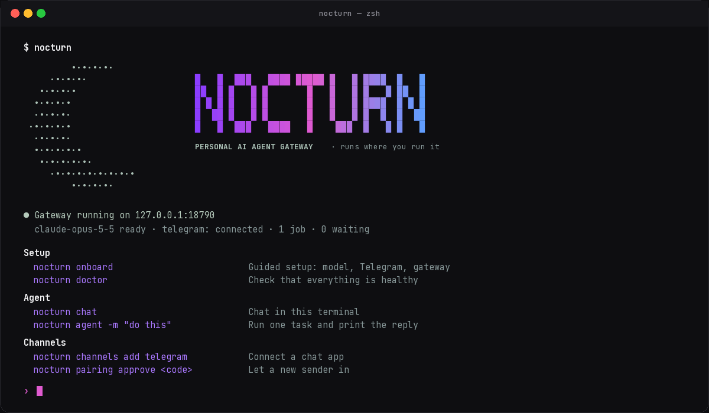
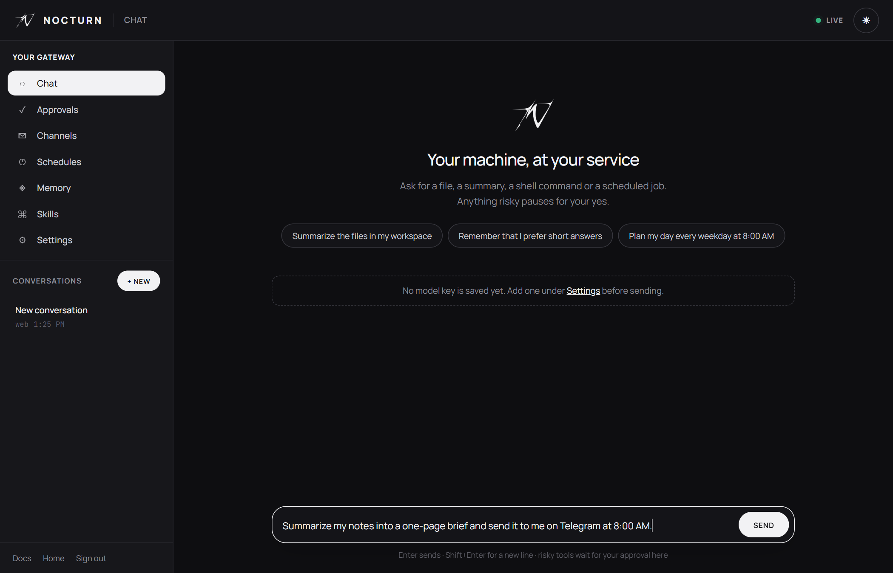
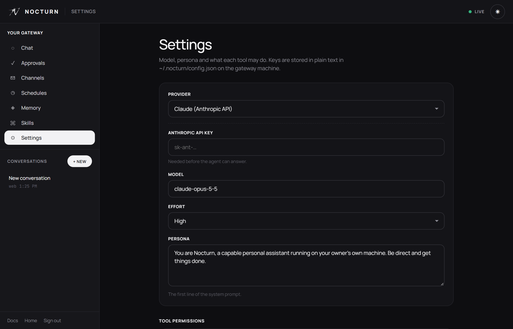
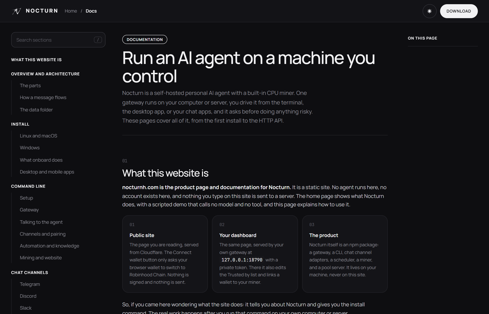
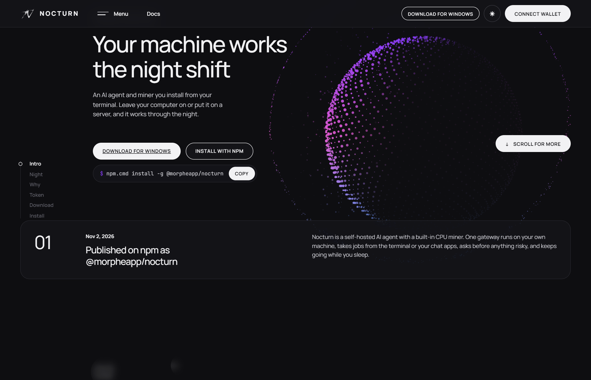
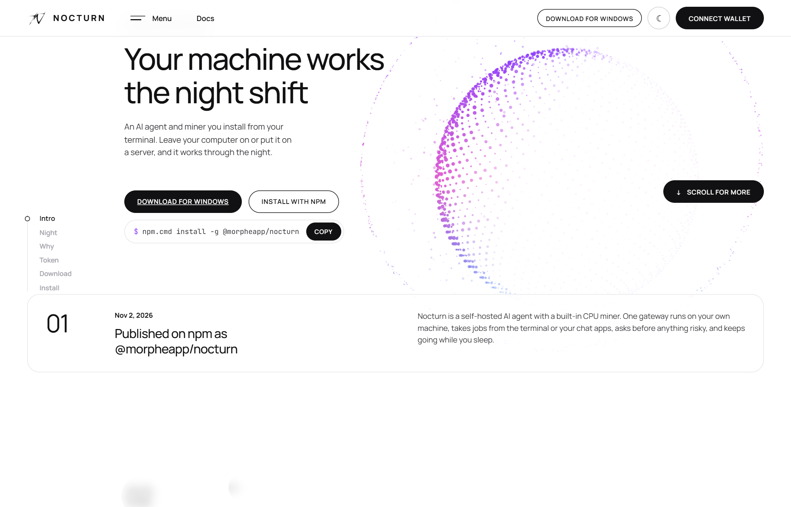
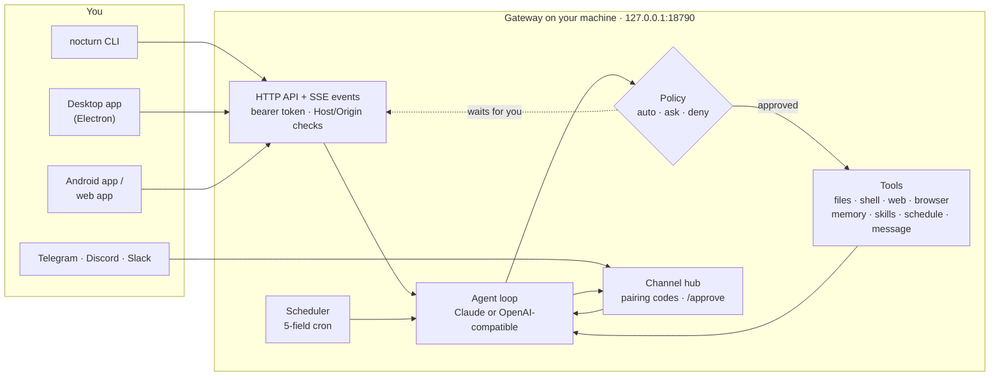

<p align="center">
  <a href="https://nocturnh.com"></a>
</p>

<p align="center">
  A self-hosted AI agent that lives on <em>your</em> computer or server, takes jobs from the terminal or your chat apps, asks before anything risky, and keeps working while you sleep.
</p>

<p align="center">
  <a href="https://www.npmjs.com/package/@morpheapp/nocturn"></a>
  <a href="https://github.com/nocturn-ai-developer/nocturn/releases/latest"></a>
  <a href="https://github.com/nocturn-ai-developer/nocturn/actions/workflows/apps.yml"></a>
  
  
  
</p>

<p align="center">
  <a href="https://nocturnh.com/#download"></a>&nbsp;
  <a href="https://github.com/nocturn-ai-developer/nocturn/releases/latest"></a>&nbsp;
  <a href="https://nocturnh.com/docs"></a>
</p>


## Sixty seconds to a running agent

Needs Node 22 or newer and a Claude key, or any OpenAI-compatible endpoint such as Ollama.

```bash
npm install -g @morpheapp/nocturn
nocturn onboard        # model, optional Telegram bot, starts the gateway
nocturn chat           # talk to it right here
```

On Windows PowerShell, use `npm.cmd install -g @morpheapp/nocturn` and `nocturn.cmd`.

Prefer an app? The desktop build starts the gateway for you and shows the control panel in its own window: **[nocturnh.com/#download](https://nocturnh.com/#download)**.


## What it looks like

<table>
  <tr>
    <td width="50%"><br><sub><b>Terminal.</b> <code>nocturn</code> shows the gateway, the model and what is waiting on you. <code>nocturn chat</code> streams replies, tool calls and approvals.</sub></td>
    <td width="50%"><br><sub><b>Control panel.</b> Chat, approvals, channels, schedules, memory, skills and settings. Served by your own gateway, also the desktop app's window.</sub></td>
  </tr>
  <tr>
    <td width="50%"><br><sub><b>Settings.</b> Provider, model, persona and a permission (always / ask / never) for every tool.</sub></td>
    <td width="50%"><br><sub><b>Docs.</b> Every command, every API route, every config key, at <a href="https://nocturnh.com/docs">nocturnh.com/docs</a>.</sub></td>
  </tr>
  <tr>
    <td width="50%"><br><sub><b>nocturnh.com, night.</b></sub></td>
    <td width="50%"><br><sub><b>nocturnh.com, day.</b></sub></td>
  </tr>
</table>


## How it works

One Node process, the **gateway**, listens on `127.0.0.1:18790` and does everything. Every other piece is a client of it.



A turn is simple: your message goes into a session, the model answers or asks for a tool, each tool call passes through its policy, anything marked **ask** pauses until you answer in the terminal, the panel, or the chat that started it, and the result goes back to the model until it is done. Sessions are JSON files, so history survives restarts.


## What it does

| | |
|---|---|
| **Talk from anywhere** | Terminal, the control panel, Telegram, Discord and Slack all reach the same gateway. Strangers get a six-digit pairing code that you approve first. |
| **Voice notes** | A Telegram voice note or a Discord audio file is transcribed first, by whisper.cpp on your machine or any OpenAI-compatible Whisper endpoint, then answered like text. |
| **Finds things by meaning** | Memories and workspace files are indexed with embeddings plus BM25, fused by reciprocal rank. `nocturn search "what did the client say"` and the agent's `search_workspace` tool use the same index. |
| **Works on a schedule** | `nocturn cron add --cron "0 8 * * 1-5" -m "plan my day" --deliver telegram:<chat>`. Five-field cron in server local time, results delivered to a chat. |
| **Remembers** | Memories carry across conversations. Skills are `SKILL.md` files in the workspace, loaded on demand. |
| **Uses real tools** | Read, write and edit workspace files, run shell commands, fetch the web, drive a headless Chrome or Edge, send chat messages, create schedules. |
| **Any model** | Claude through the Anthropic API with adaptive thinking, or any OpenAI-compatible endpoint. With a local model, prompts never leave the machine. |
| **Your data stays yours** | Keys, memory, sessions and files live in `~/.nocturn`. The gateway listens on loopback only and needs a token on every request. |
| **Mines when idle** | `nocturn mine` hashes SHA-256 on the CPU, with a thread count that backs off when the machine runs hot or low on memory. |


## It asks before it acts

Every tool has a policy. Defaults:

| Tool | Default | What it can touch |
|---|---|---|
| `read_file`, `list_files` | auto | `~/.nocturn/workspace` only, symlinks resolved |
| `memory_search`, `search_workspace`, `memory_save`, `load_skill` | auto | `~/.nocturn/memory.json`, the workspace search index, `workspace/skills` |
| `write_file`, `edit_file` | **ask** | the workspace |
| `shell` | **ask** | your whole user account, **not sandboxed** |
| `web_fetch`, `browser` | **ask** | public hosts only; loopback, LAN and cloud-metadata addresses are blocked |
| `schedule_task`, `send_message` | **ask** | the scheduler, your connected chats |

Answer approvals with `y`/`N` in `nocturn chat`, with `nocturn approvals approve <id>`, in the panel, or with `/approve` and `/deny` in the chat that started the run. Set any tool to `deny` and the model is told it is disabled. Read each shell command before allowing it, and keep `shell` on **ask** on a machine with data you care about.

<details>
<summary><b>Safety model, in full</b></summary>

- The gateway binds to `127.0.0.1`, rejects foreign `Host` and `Origin` headers (no DNS rebinding, no cross-site calls), and requires a bearer token read from `~/.nocturn/token`.
- Web pages, files, tool output and relayed chat messages are treated as data; the system prompt tells the model that instructions inside them do not come from you.
- Tool input is validated before anything runs, even when the API streamed it early.
- Chat senders are blocked until `nocturn pairing approve <code>`.
- Partner logos on the site must be real PNG, JPEG or WebP bitmaps; SVG is refused.
- Wallets are linked only with a `personal_sign` signature that recovers to the same address. No private key ever reaches Nocturn.
- Opt-in only: `NOCTURN_HOST=0.0.0.0` and `NOCTURN_TRUSTED_HOSTS=<address>` let the phone app reach a gateway over a private network such as Tailscale. Do not expose the gateway to the open internet.
</details>

<details>
<summary><b>The data folder</b></summary>

Everything lives in `~/.nocturn` (or `NOCTURN_HOME`). Never commit or share it; `config.json` holds API keys in plain text.

```
~/.nocturn/
├── config.json      provider, model, persona, policies, channel tokens
├── token            the private bearer token for the API and the panel
├── memory.json      saved memories
├── jobs.json        cron jobs
├── sessions/        one JSON file per conversation
├── workspace/       the only place file tools can read or write
│   └── skills/<name>/SKILL.md
├── browser/         the headless browser profile
├── miner.json       pool account
├── wallet.json      signed wallet link
├── gateway.pid, gateway.log
└── partners.json    the Trusted by list on your dashboard
```
</details>


## Commands

```bash
nocturn onboard                     # guided setup
nocturn gateway start|stop|restart  # background gateway (run = foreground, install = start at login)
nocturn status · doctor · dashboard # health, and the private panel link
nocturn chat                        # interactive session; /new /sessions /status /help /exit
nocturn agent -m "do this" [--json] # one task, print the reply
nocturn channels add telegram|discord|slack
nocturn pairing list|approve|deny
nocturn approvals list|approve|deny
nocturn cron list|add|rm|run|enable|disable
nocturn memory list|add|rm   ·   nocturn skills list|rm
nocturn config get|set <key> [value]
nocturn message send --to telegram:<chat> -m "text"
nocturn mine [--threads N]   ·   nocturn mine balance   ·   nocturn pool run
nocturn site build [--out folder]
```

`nocturn help` lists everything. `NOCTURN_PORT` changes the port, `NOCTURN_HOME` the state folder, `NOCTURN_BROWSER` the browser executable.

<details>
<summary><b>HTTP API</b></summary>

All routes live under `/api/`, need `Authorization: Bearer <token>`, and answer JSON. Events stream from `GET /api/events` as server-sent events (`turn_start`, `text`, `thinking`, `tool_start`, `tool_result`, `approval`, `approval_resolved`, `turn_end`, `turn_error`, `sessions_changed`, `channels_changed`, `jobs_changed`).

| Route | Does |
|---|---|
| `GET /api/state` | config (secrets redacted), sessions, approvals, channels, pairing, jobs, skills, memory |
| `PUT /api/config` | merge settings; a blank secret keeps the stored one |
| `POST /api/sessions` · `GET/DELETE /api/sessions/:id` | create, read, delete a conversation |
| `POST /api/sessions/:id/messages` · `POST /api/sessions/:id/stop` | send a message (202), stop a run |
| `POST /api/approvals/:id` · `POST /api/pairing/:code` | answer a tool request, approve a sender |
| `POST /api/jobs` · `PATCH/DELETE /api/jobs/:id` · `POST /api/jobs/:id/run` | schedules |
| `POST /api/memory` · `DELETE /api/memory/:id` · `POST /api/skills` · `DELETE /api/skills/:name` | knowledge |
| `POST /api/message` · `POST /api/allow` | send to a chat, remove an allowed sender |
| `GET/POST/DELETE /api/wallet` · `GET/POST/DELETE /api/partners` | wallet link, Trusted by list |

The full reference, with bodies and responses, is at [nocturnh.com/docs](https://nocturnh.com/docs).
</details>


## Apps

| | |
|---|---|
| **Windows** `.exe` and **macOS** `.dmg` | Nocturn Desktop (Electron, in [`desktop/`](desktop/)) boots the gateway when it opens, shows the control panel in its own window, and keeps running in the tray when the window is closed. Tray menu: open, open in browser, copy private link, start at login, quit. |
| **Android** `.apk` | A client (Capacitor, in [`mobile/`](mobile/)) for a gateway you run at home or on a server over a private network. The phone never runs the agent. |
| **Web app** | Open `/panel.html` on your own gateway and choose *Install app*. Same panel, no download. |

Downloads: **[nocturnh.com/#download](https://nocturnh.com/#download)** or the [latest GitHub release](https://github.com/nocturn-ai-developer/nocturn/releases/latest). Every installer is built from this repository by the [Apps workflow](.github/workflows/apps.yml) on a version tag.


## Mining

```bash
nocturn mine            # pick a name, answer the check, start hashing; Ctrl+C stops
nocturn mine --threads 4
nocturn mine balance
```

The check is asked once; after that the rig keeps running as long as it stays in touch with the pool, and pauses to ask again if it loses the pool for over 30 minutes. Thread count tunes itself: one fewer at 85 °C or when memory is short, one more once it is cool again. Use `tmux` on a VPS, and read your hosting provider's terms first: many forbid mining.

**Balances are in NOCT, a number kept by the pool server. NOCT is not a coin on a blockchain, cannot be withdrawn and has no guaranteed value.** The $NCTRN token on Robinhood Chain shown on the website is **not deployed yet**; check contract addresses only on nocturnh.com. Nothing here is an offer or investment advice.

<details>
<summary><b>Host your own pool</b></summary>

```bash
nocturn pool run --port 18800 --host 0.0.0.0 --trust-proxy
```

Put it behind an https reverse proxy, then set `nocturn.pool` in `package.json` to its address. The pool hands out a job per 60-second round, verifies every share itself, adjusts difficulty per miner, and splits the round's reward by work done.
</details>


## Development

```bash
npm install
npm test                 # 20 end-to-end checks against a fake model server; no key, no network
npm run desktop          # the Electron app from source
npm run desktop:win      # Windows installer into dist/   (npm run desktop:mac on macOS)
```

No framework, no build step: the gateway is plain Node, the site is plain HTML, CSS and ES modules. Three runtime dependencies: the Anthropic SDK, `@noble/curves` and `@noble/hashes`.

<details>
<summary><b>Layout</b></summary>

```
bin/nocturn.mjs      the CLI: every command is a thin client of the HTTP API
src/                 gateway: server, agent loop, providers, tools, channels, scheduler,
                     browser (CDP), miner, pool, hardware sensors, wallet proof
public/              landing page, docs, control panel, served by the gateway and by nocturnh.com
desktop/             Electron main process and icons
mobile/              Capacitor Android client
worker/              Cloudflare Worker: static site plus /download/<file> from R2
test/smoke.mjs       the test suite
.github/workflows/   apps.yml builds the .exe, .dmg and .apk on a version tag
```
</details>

<details>
<summary><b>The website</b></summary>

```bash
nocturn site build --out site
npx wrangler deploy          # npx.cmd wrangler deploy on Windows PowerShell
```

`site build` exports the landing page, docs and panel with your Trusted by list and the download links from `nocturn.downloads` in `package.json`. `wrangler.jsonc` serves it on nocturnh.com and www.nocturnh.com; installers are served from the `nocturn-downloads` R2 bucket.
</details>


## FAQ

<details><summary><b>Does the website run my agent?</b></summary>
No. nocturnh.com is a static product page and documentation. The agent runs only on a machine where you installed Nocturn. The Connect wallet button on the public site only asks your browser wallet to switch to Robinhood Chain; nothing is signed or sent.
</details>

<details><summary><b>Can I use it without an Anthropic key?</b></summary>
Yes. Choose the OpenAI-compatible provider in <code>nocturn onboard</code> and point it at Ollama, LM Studio, or any endpoint that speaks <code>/chat/completions</code>.
</details>

<details><summary><b>Is the shell tool sandboxed?</b></summary>
No. An approved command runs with your user's full permissions. Read every command before allowing it, and never set <code>shell</code> to always allow on a machine with data you care about.
</details>

<details><summary><b>Port 18790 is already in use</b></summary>
A gateway is probably running: <code>nocturn gateway status</code>. Otherwise set <code>NOCTURN_PORT</code> to another port.
</details>

<details><summary><b>PowerShell says npx.ps1 cannot be loaded</b></summary>
Use <code>npx.cmd</code>, or allow local scripts once with <code>Set-ExecutionPolicy -Scope CurrentUser RemoteSigned</code>.
</details>

<details><summary><b>Where is the private panel link?</b></summary>
<code>nocturn dashboard</code> prints it. On a server, tunnel first: <code>ssh -L 18790:127.0.0.1:18790 user@your-server</code>.
</details>

<p align="center"><sub>© Nocturn · <a href="https://nocturnh.com">nocturnh.com</a></sub></p>
